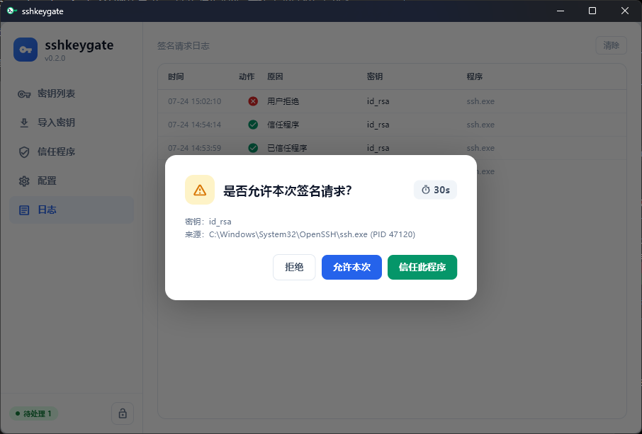

# sshkeygate

Windows SSH Agent，支持从 Bitwarden 导入密钥。纯 Dart 实现，使用 `dartssh2` 做密钥解析与签名。



## 功能

- **SSH Agent 协议** — 通过 `\\.\pipe\openssh-ssh-agent` 命名管道与 OpenSSH 原生兼容，支持 Ed25519 / RSA / ECDSA 签名
- **密钥导入** — 支持文本拖拽、文件浏览、Bitwarden 三种导入方式；加密密钥（bcrypt-pbkdf + aes256-ctr）可解密后存储
- **策略审批** — 支持每次确认、会话授权、定时授权、信任进程四种策略模式；确认弹窗提供允许本次 / 信任程序 / 拒绝三种操作，基于可执行文件路径的进程信任
- **签名确认弹窗** — 带可配置倒计时（默认 30 秒），超时自动拒绝
- **操作日志** — 所有签名请求 / 允许 / 拒绝 / 自动放行事件持久化记录，支持导出
- **系统托盘常驻** — 关闭窗口最小化到托盘而非退出，SSH Agent 持续可用
- **开机启动 / 锁屏锁定 / 超时自动锁定**

## 安全设计

### 存储加密

所有数据存储在 Windows 凭据管理器保护的单文件（`flutter_secure_storage.dat`）中。加密方案：

```
enc_key = PBKDF2-SHA256(用户密码 || device_key, salt, 100000轮)
vault   = AES-256-GCM(元数据 JSON, enc_key)
pk_{id} = AES-256-GCM(私钥 PEM 明文, enc_key)
```

- `device_key` — 32 字节随机设备密钥，确保即使密码相同，不同设备上的加密结果也不同
- 每条私钥使用独立的存储条目（`sshkeygate_pk_{id}`），而非集中存储

### 私钥不驻留内存

- **锁定态**：内存中无任何密钥数据，SSH 请求直接拒绝
- **解锁后**：内存仅保留元数据（名称、算法、指纹、公钥 blob），**不含私钥**
- **签名时**：按需解密单条私钥 → `dartssh2` 签名 → 立即丢弃

### 静态密钥保护

- 导入加密密钥时使用 passphrase 解密，存储解密后的无密码 PEM
- 不存储用户 passphrase，避免凭据泄漏风险

### 进程可信

- 基于可执行文件路径（不区分大小写）的信任白名单
- 通过 FFI 调用 `GetNamedPipeClientProcessId` + `QueryFullProcessImageNameW` 获取请求进程的真实路径
- 任何策略下，已信任程序均自动放行签名请求

### 锁屏检测

- FFI 调用 `OpenInputDesktop` 轮询检测桌面锁定状态
- 检测到锁屏后自动锁定 vault，清除内存密钥

## 数据存储位置

| 文件 | 路径 |
|------|------|
| 加密存储 | `%APPDATA%\com.sshkeygate\sshkeygate\flutter_secure_storage.dat` |
| 操作日志 | `%APPDATA%\com.sshkeygate\sshkeygate\agent.log` |


