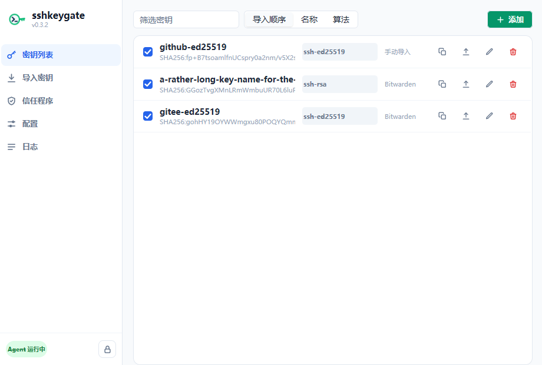
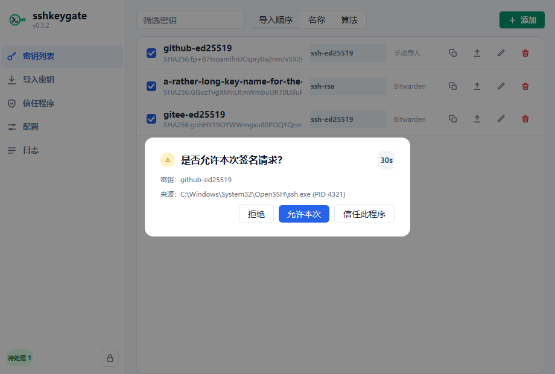
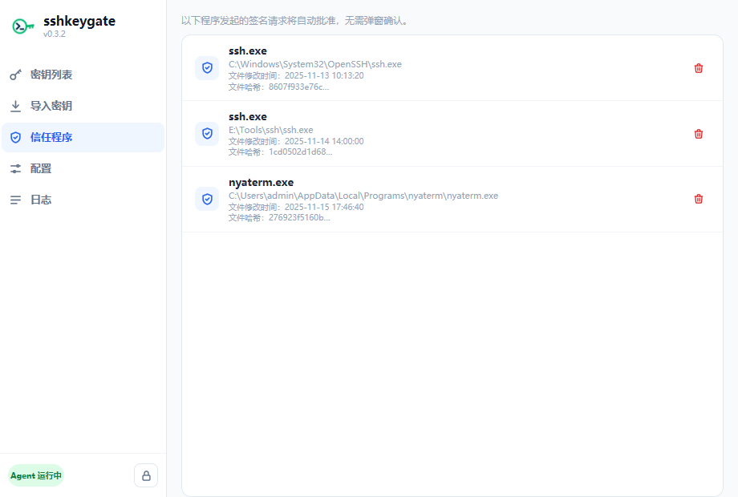
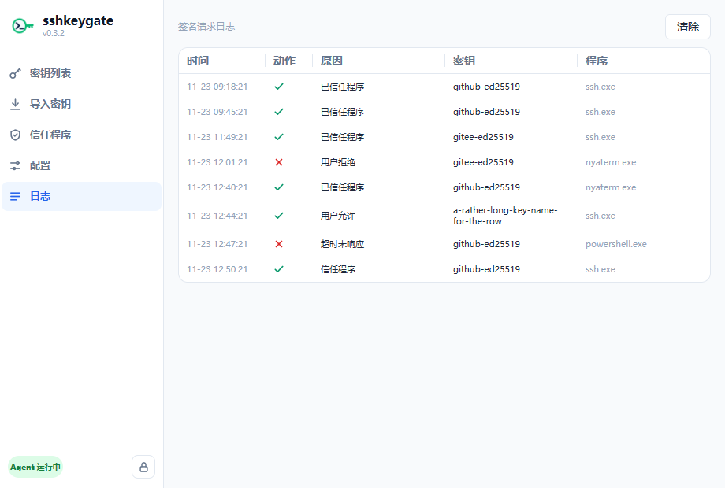
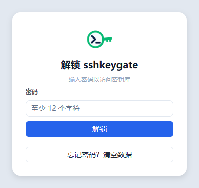
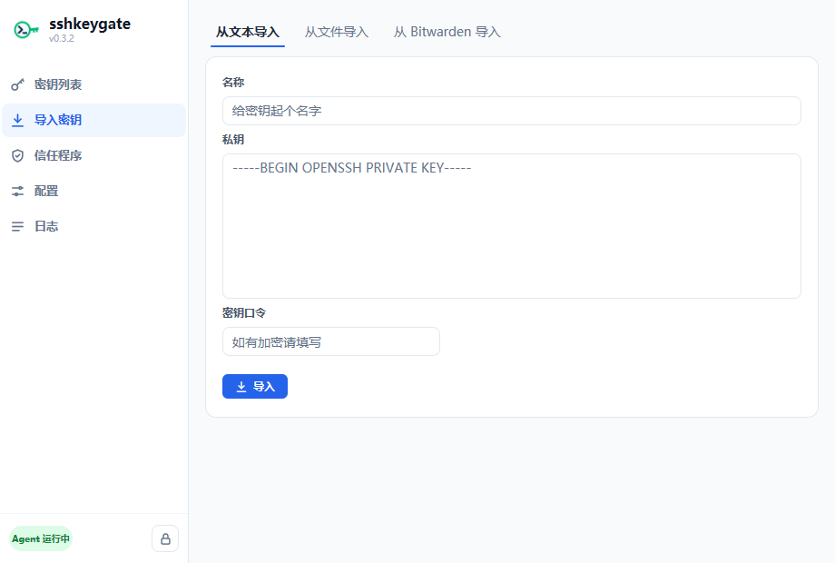
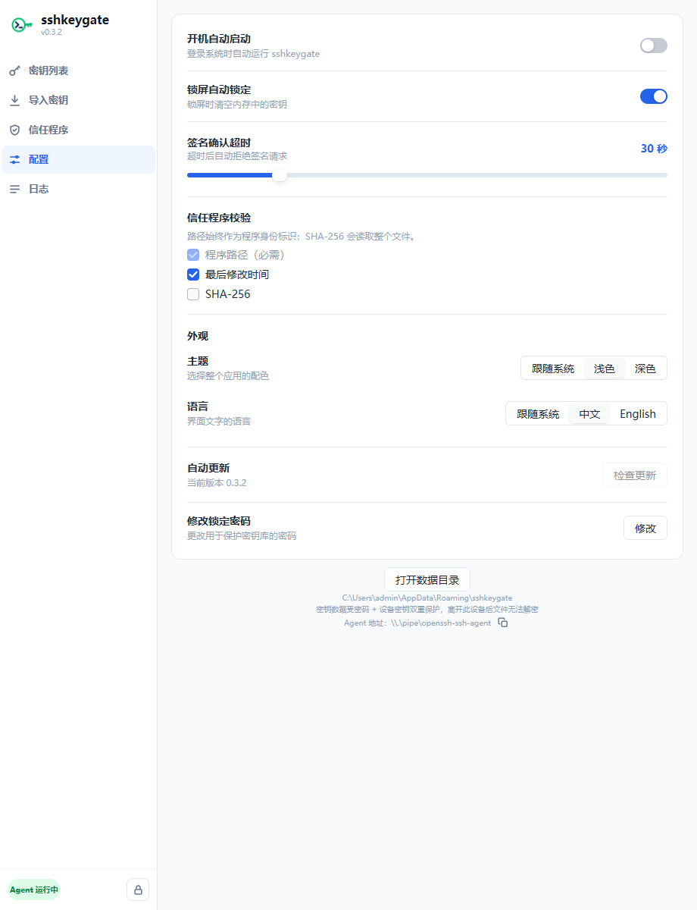

# sshkeygate

跨平台 SSH Agent（Windows / macOS），用纯 Go 编写，UI 基于 [MyGo](https://github.com/egoist/mygo) 原生 `ui` 包绘制。支持从 Bitwarden / Vaultwarden 导入密钥。

## 截图

浅色主题的中文界面，深色与英文同样支持。

| 密钥列表 | 签名确认 |
|---|---|
|  |  |
| 名称、指纹、算法、来源逐行对齐 | 每次签名都要确认，可把程序加入信任列表 |

| 信任程序 | 日志 |
|---|---|
|  |  |
| 信任记录保存路径、修改时间与 SHA-256 | 每次签名请求的结果都留痕 |

解锁页 —— 密码 + 设备密钥双重保护，忘了只能清空重来。



导入 —— 文本、文件、Bitwarden 三种来源，Vaultwarden 走同一个接口。



配置 —— 开机启动、锁屏锁定、确认超时、信任校验项、外观与语言、自动更新。



## 功能

- **SSH Agent** — 与 OpenSSH 原生兼容；Windows 走 `ssh.exe` 默认的同名管道，macOS 通过 `SSH_AUTH_SOCK` 接入。支持 Ed25519 / RSA / ECDSA
- **密钥导入** — 文本粘贴、拖拽文件、扫描 `~/.ssh` 目录（可识别加密密钥并填入口令）、Bitwarden / Vaultwarden 同步
- **密钥管理** — 按名称或指纹筛选，按导入顺序 / 名称 / 算法排序，可导出为 PEM
- **签名审批** — 每次签名都在弹窗里确认（超时自动拒绝）；把发起程序加入「信任程序」后自动放行
- **签名确认弹窗** — 可配置倒计时（10–120 秒，默认 30），超时自动拒绝；并发请求排队，一次只展示一个
- **进程识别** — 每次请求都识别发起签名的程序；无法识别来源时永不自动放行
- **信任程序校验** — 以可执行文件为身份，可选校验最后修改时间与 SHA-256
- **操作日志** — 记录每次签名请求的处理结果（允许、拒绝、超时、信任等），可随时清空
- **常驻托盘** — 关窗只隐藏窗口，Agent 继续服务；左键点图标唤回窗口，右键出菜单
- **自动更新** — 配置页检查、下载并原地安装；更新包经过签名校验，只接受本项目发布的版本
- **单实例** — 重复启动会回到已运行的窗口
- **忘记密码可重来** — 密码无法找回，解锁页提供「清空数据」：两次确认后删除密钥库、私钥、日志与界面偏好，回到初次运行
- **开机启动 / 锁屏自动锁定**
- **浅色 / 深色 / 跟随系统**、**中英双语**

主题与语言默认跟随系统；在「配置 → 外观」里选定后则以所选为准。

## 下载

从 [Releases](https://github.com/howmp/sshkeygate/releases) 获取最新版本：

| 平台 | 文件 |
|------|------|
| Windows x64 | `sshkeygate-<version>-windows-amd64.exe` |
| macOS 11+（Intel + Apple Silicon） | `sshkeygate-<version>.dmg` |

Windows 版没有安装程序：下载后请把 exe 改名为 `sshkeygate.exe` 再运行。自动更新按这个
文件名原地替换；保留带版本号的文件名时，更新会另外放一个 `sshkeygate.exe`，当前运行的
旧文件不会被替换。

macOS 包目前未签名公证（ad hoc 签名），首次打开会被 Gatekeeper 拦下。macOS 15 起在
「系统设置 → 隐私与安全性」里选「仍要打开」（更早的系统可以右键 → 打开），或执行：

```bash
xattr -dr com.apple.quarantine /Applications/sshkeygate.app
```

自动更新要求当前用户能写应用所在的目录：可以是管理员用户把应用拖进 `/Applications`，或
放进 `~/Applications` 之类的位置。当前用户没有写权限时，配置页会说明只能手动下载新版本。

## 客户端接入

- **Windows**：`ssh.exe` 默认连接 `\\.\pipe\openssh-ssh-agent`，本程序使用同名管道。
  若系统的 OpenSSH Authentication Agent 服务正在运行，它会占用同一个管道，ssh 的请求
  可能落到它而不是本程序。先停用该服务（以管理员身份运行
  `Set-Service ssh-agent -StartupType Disabled` 并重启），再启动本程序。
- **macOS**：把 socket 路径告诉客户端（配置页底部有复制按钮）
  ```bash
  export SSH_AUTH_SOCK="$HOME/.sshkeygate/agent.sock"
  ```

## 安全

- **密钥加密保存在本地** — 私钥以 AES-256-GCM 加密落盘，密钥由你的密码与本机凭据库中的设备密钥共同派生。换一台机器、或只拿到数据文件，都无法解密
- **密码不落盘** — 密码只在解锁时使用，不写入任何文件；手动锁定，以及开启「锁屏自动锁定」（默认开启）时的锁屏，都会立即清除内存中的解密密钥，SSH 请求直接失败
- **私钥按需使用** — 解锁期间内存不保留任何私钥；每次签名才解密单条，用完立即擦除
- **本地爆破代价高** — 每次密码尝试都要经过一次刻意放慢的密钥派生，连续输错还会逐步延迟
- **导入的加密密钥不再需要口令** — 导入时用口令解密一次，之后由密钥库统一保护
- **忘记密码无法找回** — 没有后门，只能清空数据重新开始

需要说明的是：私钥在签名的那一刻必然出现在进程内存中，Go 运行时、底层密码库和操作系统
（页文件、崩溃转储）都可能留下应用无法清除的副本。因此应用尽力缩短暴露时间、擦除自己持有
的缓冲区，但**不承诺进程内存中绝无残留**，也不把内存擦除当作抵御本机实时读取的措施。

## 数据位置

| 平台 | 数据目录 |
|------|---------|
| Windows | `%APPDATA%\sshkeygate` |
| macOS | `~/Library/Application Support/sshkeygate` |

密钥库、加密的私钥、审计日志与界面偏好都在这个目录里。设备密钥不在其中，而是存放在
Windows Credential Manager / macOS Keychain：只备份这个目录，换一台机器或重装系统后
无法解密。需要迁移时请在应用里导出私钥。

## 已知限制

- 仅 Windows 与 macOS（Linux 尚未实现）
- 不支持一个文件包含多把私钥，不支持 SSH 证书签名
- 不支持无法从内存中擦除的密钥类型（当前如 ML-DSA）
- macOS 包未签名公证，需手动放行
- 进程内存无法保证完全擦除（见上文「安全」）

## 开发

构建、打包、发版、安全实现细节与设计决策见 [DEV.md](DEV.md)。
